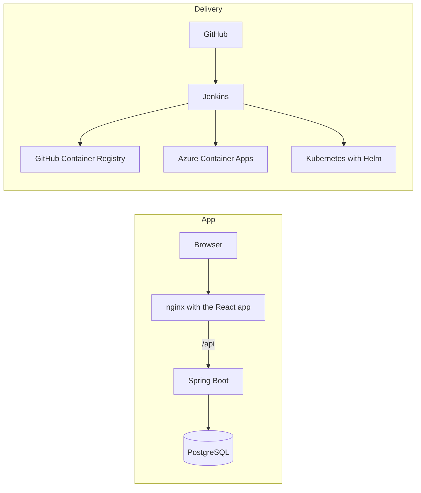

# Pour & Plate

**Live demo:** https://pourandplate.se

> The app scales to zero when nobody is using it, so the first visit can take up to a minute while it wakes up. Accounts are invite only, so ask me for a demo login.

I love food, beer and wine, and I brew my own beer. Whenever friends, family or I find a good restaurant, wine or beer, I want an easy way to remember it and share it. I also want to keep track of new places I'd like to go.

Most apps are pretty bad at finding hidden gems. So the idea is simple: a map that shows restaurants with their average score, my own recommendations, and the places I want to visit.

## Screenshots

| The map | Top rated |
| --- | --- |
|  |  |
| **Near me** | **My stats** |
|  |  |
## What it does

- A map of about 45,000 food and drink places in Sweden, from Overture Maps and OpenStreetMap, grouped into bubbles that split up as you zoom in
- Places that have probably closed (a new place opened at the same address) are hidden from the map, but you can still find them in search with a warning
- Click a place to save it as want to visit, or as visited with a rating for food, atmosphere and value for money (1 to 10). My score is the average of the three
- Notes, the restaurant's website, and Google's own rating in a small Google Maps box
- Friends join through single use invite links that expire after 15 minutes
- A side panel with my map, every friend's map (read only) and an Everyone map that shows who has been where and the shared average score
- Works on phone and computer
- Search for any place by name, or tap Near me to see what is closest, filtered by type and distance
- Filter the map by restaurants, cafés, wine bars, beer places or bars
- Top rated: the best places by everyone's average score, as numbered pins with gold for the top 3. A place needs at least 2 reviews to be ranked. Pick a kind too, like bars, and you get the top bars
- Go together: places two or more of us want to visit
- My stats: my taste profile per kind of food, and the latest from my friends

## Tech stack

- **Backend:** Java 25, Spring Boot 4, Spring Security (session login, BCrypt, CSRF), Spring Session JDBC, Maven
- **Database:** PostgreSQL 18 with Flyway migrations, hand written SQL for the summaries and rankings
- **Frontend:** React, TypeScript, Vite, Leaflet with a MapLibre vector map
- **Data:** DuckDB to read and merge Overture Maps and OpenStreetMap
- **Containers:** Docker multi stage builds, nginx, Docker Compose
- **Kubernetes:** Helm chart, Gateway API with Envoy Gateway, StatefulSet for Postgres, health probes
- **Cloud:** Azure Container Apps (scales to zero), Azure Database for PostgreSQL, GitHub Container Registry, own domain with free managed certificates
- **Tests:** JUnit, Mockito and Testcontainers
- **CI/CD:** Jenkins pipeline that runs the tests, builds both images tagged with the commit id, pushes them, and deploys to both Azure and my local Kubernetes cluster on every commit

## Architecture



The browser only talks to nginx. nginx serves the React app and sends every `/api` call on to Spring Boot, so the backend is never open to the internet on its own. On Azure the backend is internal and only the frontend is public.

## SQL highlights

All queries are hand written native SQL in Spring Data `@Query`, each with an integration test against a real PostgreSQL in Testcontainers.

| Feature       | What it does | SQL idea |
|---------------| --- | --- |
| Search      | Find any of the 45,000 places by part of its name, best match first | `pg_trgm` extension with a GIN index, so `ILIKE '%text%'` stays fast, sorted by `similarity()` ([V12](tasting-service/src/main/resources/db/migration/V12__place_name_search.sql), [query](tasting-service/src/main/java/se/svent/tasting/place/PlaceRepository.java)) |
| Map filter  | Restaurants, cafés, wine bars, beer places and bars | A `GENERATED ALWAYS AS (CASE WHEN ...) STORED` column works out each place's kind from its category and name ([V15](tasting-service/src/main/resources/db/migration/V15__kinds_focus_rule.sql)) |
| Near me       | The closest places within 500 m to 2 km, with the distance in meters | Haversine formula in a derived table, after a cheap bounding box that uses the index ([query](tasting-service/src/main/java/se/svent/tasting/place/PlaceRepository.java)) |
| Top rated     | The best places by everyone's average, at least 2 reviews each | `GROUP BY` with `HAVING COUNT(*) >= 2`, and `RANK() OVER (ORDER BY ...)` for the numbers. With a kind filter, `RANK` runs after `WHERE`, so the best bar becomes number 1 ([query](tasting-service/src/main/java/se/svent/tasting/restaurant/RestaurantRepository.java)) |
| Go together   | Places two or more of us want to visit | `GROUP BY` with `HAVING COUNT(*) >= 2` and `STRING_AGG` for the names ([query](tasting-service/src/main/java/se/svent/tasting/restaurant/RestaurantRepository.java)) |
| Taste profile | My average score per kind of food | `JOIN` between my reviews and the places, `AVG` and `ROUND` per category ([query](tasting-service/src/main/java/se/svent/tasting/restaurant/RestaurantRepository.java)) |
| Latest from friends | The newest three reviews from each friend | Window function `ROW_NUMBER() OVER (PARTITION BY user ORDER BY updated_at DESC)` for top N per group ([query](tasting-service/src/main/java/se/svent/tasting/restaurant/RestaurantRepository.java)) |
| Everyone map  | Each place once, with who visited, who wants to go and the shared score | `COUNT(*) FILTER (WHERE ...)`, `AVG`, `STRING_AGG` ([query](tasting-service/src/main/java/se/svent/tasting/restaurant/RestaurantRepository.java)) |

## Data pipeline

The places come from two open sources, and neither is perfect on its own. Overture has more places but some are old, OpenStreetMap is often more up to date. The scripts are in [`scripts/`](scripts) and the [scripts README](scripts/README.md) has the monthly refresh order.

- Read the newest Overture release with DuckDB, skip places marked as closed
- Remove duplicates by comparing names after taking out generic words like "restaurang" or "pizzeria" (a `core_name()` SQL function)
- Read the OpenStreetMap file for Sweden with DuckDB spatial, both points and building outlines
- Match the two by distance and name similarity: about 11,500 places were confirmed by both, and about 8,400 places that only OpenStreetMap had were added
- Places where a new place opened at the same address are marked `likely_closed` and hidden from the map instead of deleted

## CI/CD and deployment

Jenkins runs in Docker on my PC and checks GitHub every 5 minutes. On every new commit it:

1. Runs all backend tests in a Maven container, with Testcontainers starting a real PostgreSQL
2. Builds the backend and frontend images, tagged with the commit id instead of `latest`, so I always know which code is running where
3. Pushes them to GitHub Container Registry
4. Deploys to Azure Container Apps with a service principal that only has access to this resource group
5. Deploys to my local Kubernetes cluster with `helm upgrade --install`, and fails the build if the new pods never get healthy

## Design decisions

- **One service instead of microservices.** I first planned a separate C# service with RabbitMQ for the statistics. For an app this size that would only add more to deploy and keep in sync, so everything stays in one Spring Boot backend.
- **A plain average instead of a Bayesian average for Top rated.** A Bayesian average adds made up reviews in the middle, so two people giving a place 1/10 still ended up around 4.6. With a small group of friends that was misleading. Instead a place needs at least 2 real reviews, and the score shown is exactly the one used for the ranking.
- **Hide instead of delete.** A place that has probably closed is hidden from the map, but kept in the database. My friends' reviews of it are never lost, and it can still be found in search.
- **No foreign key from reviews to places.** The places are refreshed every month from outside sources, so a place can disappear. A review should never be deleted just because the source data changed.
- **Gateway API instead of Ingress.** The usual ingress-nginx controller was retired in March 2026, so the Kubernetes setup uses the Gateway API with Envoy Gateway, which is the official successor.
- **Sessions in PostgreSQL.** The backend runs as several copies and scales to zero on Azure. Keeping sessions in the database means you stay logged in no matter which copy answers, or if it restarts.

## Run locally

You need Docker Desktop. Create a `.env` file next to `docker-compose.yml`:

```
ADMIN_PASSWORD=choose-a-password
VITE_GOOGLE_MAPS_KEY=optional-google-embed-key
```

Then start everything:

```
docker compose --profile app up -d --build
```

Open http://localhost:8080 and log in as `svent` with your admin password.

For development, `docker compose up -d` starts only the database. Then run the backend from IntelliJ (port 8081) and the frontend with `npm run dev` in `frontend` (port 5173).

## Run on Kubernetes

Tested with the Kubernetes that comes with Docker Desktop. You also need `helm`.

```
# build the images, the cluster uses the same local docker
docker compose --profile app build

# the namespace and the secrets, the passwords never go in a file
kubectl apply -f k8s/namespace.yaml
kubectl create secret generic postgres-secret --namespace pour-and-plate --from-literal=POSTGRES_USER=pourplate --from-literal=POSTGRES_PASSWORD=choose-a-password --from-literal=POSTGRES_DB=tasting
kubectl create secret generic backend-secret --namespace pour-and-plate --from-literal=SPRING_DATASOURCE_PASSWORD=choose-a-password --from-literal=ADMIN_PASSWORD=choose-a-password

# envoy gateway, once per cluster
kubectl apply --server-side -f https://github.com/envoyproxy/gateway/releases/download/v1.7.5/install.yaml

# the whole app
helm install pour-and-plate helm/pour-and-plate --namespace pour-and-plate
```

Open http://localhost. Both passwords in `SPRING_DATASOURCE_PASSWORD` and `POSTGRES_PASSWORD` must be the same.

## API

Everything except login and invites needs a logged in session. Requests that change something also need the `X-XSRF-TOKEN` header.

| Method | URL | What it does |
| --- | --- | --- |
| `POST` | `/api/auth/login` | Log in |
| `GET` | `/api/auth/me` | Who is logged in |
| `GET` | `/api/places?south=&west=&north=&east=&kinds=` | Places inside the visible map area, only the chosen kinds |
| `GET` | `/api/places/search?q=` | Search places by name |
| `GET` | `/api/places/near?lat=&lon=&radius=&kinds=` | The closest places, with distance in meters |
| `GET` | `/api/restaurants` | My saved places (`?status=VISITED` or `WANT_TO_VISIT`) |
| `GET` | `/api/restaurants/{id}` | One of my saved places |
| `POST` | `/api/restaurants` | Save or rate a place. Same `placeId` again updates it |
| `DELETE` | `/api/restaurants/{id}` | Remove one of mine (403 if it is someone else's) |
| `GET` | `/api/restaurants/summary` | Every saved place combined, with counts and average score |
| `GET` | `/api/restaurants/top?kinds=` | The top rated places, at least 2 reviews each, optionally only some kinds |
| `GET` | `/api/restaurants/together` | Places two or more of us want to visit |
| `GET` | `/api/restaurants/taste` | My average ratings per kind of food |
| `GET` | `/api/restaurants/activity` | The newest reviews from my friends |
| `GET` | `/api/users` | Everyone, with how many places they visited and want to visit |
| `GET` | `/api/users/{id}/restaurants` | A friend's map, read only |
| `POST` | `/api/invites` | Create an invite link (admin only) |
| `POST` | `/api/invites/{token}/accept` | Create an account from an invite |

## Tests

```bash
cd tasting-service
./mvnw test
```

37 tests: unit tests for the rating rules, service tests with Mockito, and integration tests that start a real PostgreSQL in Docker with Testcontainers and send real HTTP requests to the app, logged in with CSRF like a browser. Docker needs to be running.

## What I learned so far

- The hardest part was narrowing down exactly what I wanted to build. I started with wine, beer and restaurants all at once, and ended up focusing on restaurants first.
- I like errors. Sitting with a problem until I understand why it happens is how I learn the most.
- Getting the app online took a lot longer than I expected. Pushing my Docker images to GitHub's container registry kept failing with "denied", and once the app was on Azure I couldn't log in at all. After a couple of hours of reading logs I found the cause: nginx was still calling the backend on the wrong port.
- Some bugs only showed up in special cases. A popup near the top of the map got stuck half see-through, and it turned out React was giving it a "new" position on every redraw, which made the map reopen it over and over.
- I learned the hard way that you never edit a database migration after it has run. I changed the formatting of an old Flyway file, and the app refused to start until I understood why.
- Every new idea meant going back and changing code I had already written. I spent a lot of time trying to keep the code clean and not repeat myself, for example by making small components that the popups could share.

## Next steps

- Wine and beer sections, with my own recommendations
- My own corrections for places that have the wrong type, and a way to add missing places
- A separate small project in C# and .NET

## Author

[GitHub](https://github.com/Jeffdsv)